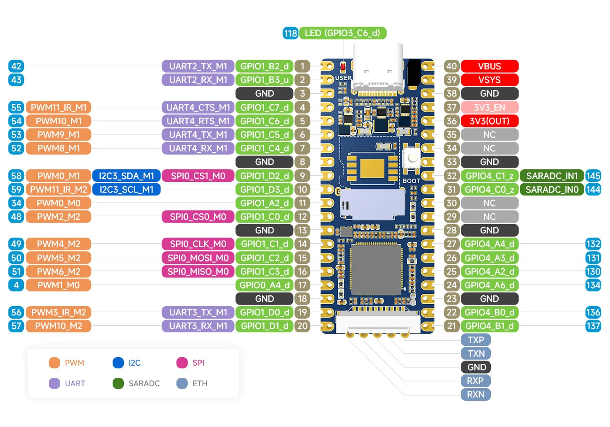
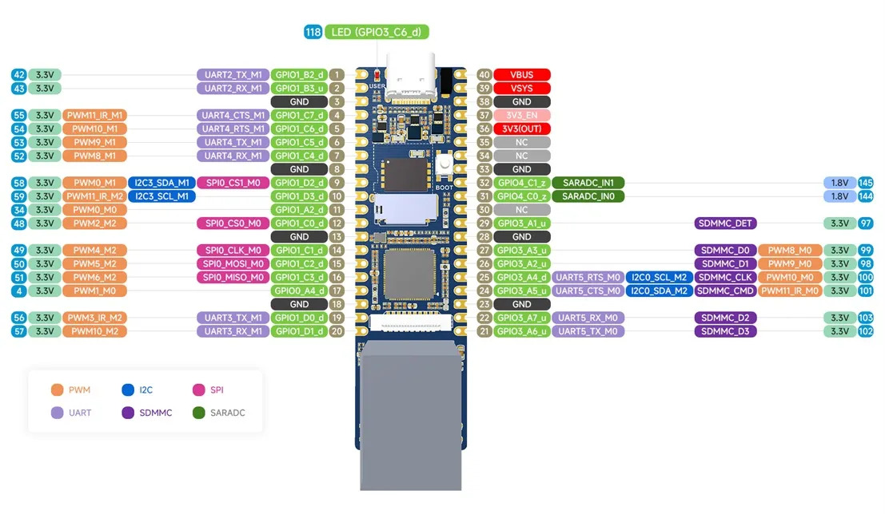
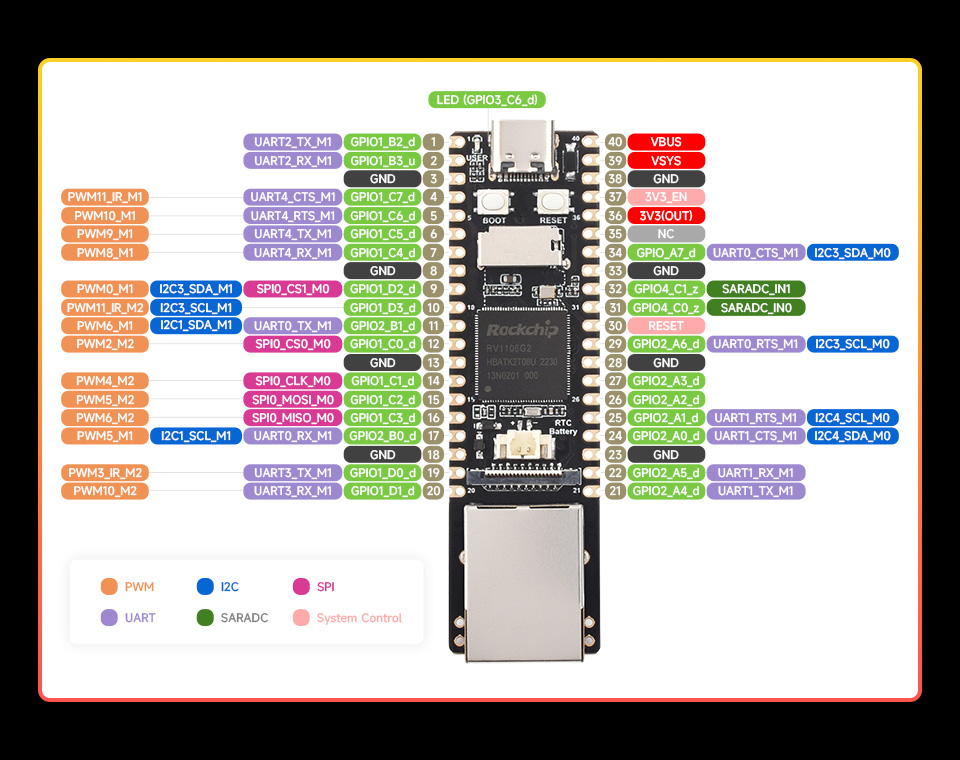
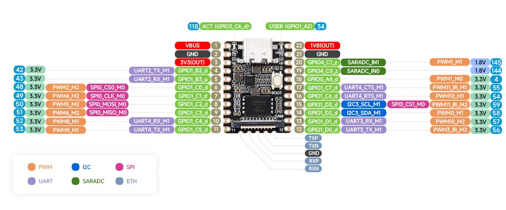

# meta-rv110x

Yocto BSP layer for Rockchip boards based on RV1103/RV1106.

## Description

The purpose of this layer is to provide OpenEmbedded BSP support for
Rockchip boards based on RV1103/RV1106 using ported rockchip-linux sources.

## Supported boards

| Name | Link | GPIO |
|------|------|------|
| Luckfox Pico | <https://www.luckfox.com/Luckfox-Pico> |  |
| Luckfox Pico Plus | <https://www.luckfox.com/Luckfox-Pico-Plus> |  |
| Luckfox Pico Max | <https://www.luckfox.com/Luckfox-Pico-Max> |  |
| Luckfox Pico Mini A/B | <https://www.luckfox.com/Luckfox-Pico-Mini-A> |  |
| Luckfox Pico Pi | <https://www.luckfox.com/Luckfox-Pico-Pi> |  |

## Product selection

| Product | Main chip | Memory | NPU | ISP | Default storage | Features |
|---------|-----------|--------|-----|-----|-----------------|----------|
| [Luckfox Pico Mini A](https://www.luckfox.com/Luckfox-Pico-Mini-A) | RV1103G | 64MB | 0.5TOPS, supports int4, int8 and int16 | Input 4M @30fps (Max) | TF card (Not included) | Onboard Type-C port, MIPI CSI Interface, GPIO, etc. |
| [Luckfox Pico Mini B](https://www.luckfox.com/Luckfox-Pico-Mini-B) | RV1103G | 64MB | 0.5TOPS, supports int4, int8 and int16 | Input 4M @30fps (Max) | SPI NAND FLASH (128MB) | Onboard Type-C port, MIPI CSI Interface, GPIO, etc. |
| [Luckfox Pico](https://www.luckfox.com/Luckfox-Pico) | RV1103G | 64MB | 0.5TOPS, supports int4, int8 and int16 | Input 4M @30fps (Max) | TF card (Not included) | Onboard Type-C port, MIPI CSI Interface, GPIO, etc. |
| [Luckfox Pico Plus](https://www.luckfox.com/EN-Luckfox-Pico-Plus.htm) | RV1103G | 64MB | 0.5TOPS, supports int4, int8 and int16 | Input 4M @30fps (Max) | SPI NAND FLASH (128MB) | Onboard Type-C port, MIPI CSI Interface, GPIO, Ethernet port, etc. |
| [Luckfox Pico Pro](https://www.luckfox.com/EN-Luckfox-Pico-Pro) | RV1106G | 128MB | 0.5TOPS, supports int4, int8 and int16 | Input 5M @30fps (Max) | SPI NAND FLASH (256MB) | Onboard Type-C port, MIPI CSI Interface, GPIO, Ethernet port, RTC battery header, etc. |
| [Luckfox Pico Max](https://www.luckfox.com/Luckfox-Pico-Max) | RV1106G | 256MB | 0.5TOPS, supports int4, int8 and int16 | Input 5M @30fps (Max) | SPI NAND FLASH (256MB) | Onboard Type-C port, MIPI CSI Interface, GPIO, Ethernet port, RTC battery header, etc. |
| [Luckfox Pico Pi](https://www.luckfox.com/Luckfox-Pico-Pi) | RV1106G | 128MB | 0.5TOPS, supports int4, int8 and int16 | Input 5M @30fps (Max) | eMMC (8GB) | Onboard Type-C port, MIPI CSI Interface, GPIO, Ethernet port, WiFi 6/BT 5.2 (AIC8800DC), etc. |

## Machine configurations

There are 10 machines: each of the 5 boards comes in a `-sd-card` variant (SD card, wic image) and a `-spi-nand` variant (SPI NAND, UBI image, spi-nand U-Boot). Optional features are controlled via the `LUCKFOX_FEATURES` variable.

| Machine | Board | SoC |
|---------|-------|-----|
| `luckfox-pico-sd-card`, `luckfox-pico-spi-nand` | Luckfox Pico | RV1106 |
| `luckfox-pico-plus-sd-card`, `luckfox-pico-plus-spi-nand` | Luckfox Pico Plus | RV1106 |
| `luckfox-pico-max-sd-card`, `luckfox-pico-max-spi-nand` | Luckfox Pico Max | RV1106 |
| `luckfox-pico-mini-sd-card`, `luckfox-pico-mini-spi-nand` | Luckfox Pico Mini A/B | RV1103G |
| `luckfox-pico-pi-sd-card`, `luckfox-pico-pi-spi-nand` | Luckfox Pico Pi | RV1106 |

### Feature flags (`LUCKFOX_FEATURES`)

Features are space-separated tokens passed via `LUCKFOX_FEATURES` (in `local.conf`, environment, or VS Code build configuration). The default is `camera aic8800dc npu vcodec`.

| Feature | Description |
| --- | --- |
| `camera` | MIPI CSI camera stack (SC3336 sensor, CIF, ISP1) |
| `aic8800dc` | AIC8800DC WiFi/BT via SDIO (kernel modules, firmware, init, wpa-supplicant, bluez5) |
| `npu` | Rockchip NPU kernel driver (rknpu) |
| `vcodec` | VPU/VIDEO codec kernel drivers (RGA, VDEC) |

**Examples:**
- SD card boot with all features (default): `MACHINE=luckfox-pico-max-sd-card`
- SPI NAND boot: `MACHINE=luckfox-pico-max-spi-nand`
- Minimal build (no camera, no WiFi, no NPU): `MACHINE=luckfox-pico-sd-card LUCKFOX_FEATURES=""`

The Mini A/B boards use a single machine configuration (`luckfox-pico-mini`) with the Mini B device tree (which includes the SPI NAND node). When booting from SD card, the NAND is exposed as MTD for updates. When booting from NAND, use the `-spi-nand` machine.

WiFi 6 (802.11ax) and Bluetooth 5.2 are provided by the AIC8800DC module, which plugs into the SD card slot and is driven over SDIO. Every machine in this layer installs the driver, firmware and init scripts when the `aic8800dc` feature is enabled (enabled by default), so the module works on any board that has the slot populated.

Features are not split into extra machines: camera support and the USB serial console are part of every machine that can use them (controlled via `LUCKFOX_FEATURES`). Root filesystem auto-resize is installed only on SD card machines.

## Development status

- [x] Initial support in u-boot
- [x] Initial support in linux kernel
- [x] Ethernet with static MAC
- [x] Boot from NAND
- [x] USB host and gadget support
- [x] Camera serial interface (SC3336) on all boards
- [x] Vision processor (VPU): RGA, ISP, VEPU/VDPU, VICAP
- [ ] NPU (RKNN): no RV1103/RV1106 driver in the mainline kernel, see below
- [x] WiFi 6 / Bluetooth 5.2 (AIC8800DC) on all boards with an SD card slot
- [ ] RAUC support for SD card
- [ ] RAUC support for NAND
- [ ] Support for some display controllers

## Additional features

Some functionality is not a device tree detail but a recipe the layer installs
into the image.

### Root filesystem auto-resize

The `.wic` images are built to a fixed size, so a freshly flashed card would
leave most of its capacity unused. The SD card machines depend on
`resize-rootfs`, a one-shot init script that runs on first boot and grows the
root partition and filesystem to the end of the card. It is a no-op afterwards,
guarded by `/var/lib/resize-rootfs.done`.

The script handles the fact that the root partition is in use: `sfdisk` rewrites
the table with `--no-reread`, and the kernel is updated with `partx -u`, which
falls back to the `BLKPG` resize ioctl when the partition cannot be deleted
because it is mounted.

### USB serial console

Every board exposes its USB port as a CDC-ACM serial device, so the board can be
logged into over the same cable that powers it, without a separate UART. The
gadget must be created from `rcS` (`start 41 S .`): `ttyrun` calls
`pause()` when the tty does not exist yet, which would block the login prompt.

### Camera (SC3336 on MIPI CSI)

Every machine enables the vendor camera stack, so attaching a Smartsens SC3336
module to the board's MIPI CSI connector works without any extra configuration:

```
SC3336 -> CSI2 DPHY (2 lanes, 510 Mbps) -> MIPI CSI2 receiver -> CIF -> /dev/video0
```

This needs no dedicated machine: the device tree of every board includes
`rv1106-camera.dtsi`, which describes the sensor, the CSI chain and the buffer
memory, and the machine includes pull in four modules: `sc3336`,
`phy-rockchip-csi2-dphy`, `phy-rockchip-csi2-dphy-hw` and
`rockchip-cif-vendor`, plus `v4l-utils` and `i2c-tools` for debugging. Boards
without a camera attached still boot normally; the sensor simply fails to probe
with `sc3336 4-0030: Unexpected sensor id(000000)`.

#### Capturing a frame

There is no ISP driver in this kernel, so the CIF hands out the raw Bayer data of
the sensor's only mode, 2304x1296 @ 30 fps:

```sh
v4l2-ctl -d /dev/video0 --set-fmt-video=width=2304,height=1296,pixelformat=BG10 \
  --stream-mmap=2 --stream-count=1 --stream-to=/tmp/frame.raw
```

The layout is Rockchip "compact" RAW10: 4 pixels packed in 5 bytes, and each
line padded to a 256-byte boundary (`ALIGN(2304 * 10 / 8, 256) = 3072`), so a
frame is `3072 * 1296 = 3981312` bytes. Use `media-ctl -p` to inspect the media
graph and `cat /proc/rkcif-mipi-lvds` for the clock/error statistics.

### WiFi 6 / Bluetooth 5.2 (AIC8800DC)

The AIC8800DC module plugs into the SD card slot and is driven over SDIO. It is
supported by the `aic8800dc` recipe, which builds three out-of-tree modules:

| Module | Purpose |
|--------|---------|
| `aic8800_bsp` | SDIO bus glue and firmware download |
| `aic8800_fdrv` | Full MAC 802.11ax driver |
| `aic8800_btlpm` | Bluetooth low-power management |

The driver source is taken from [radxa-pkg/aic8800](https://github.com/radxa-pkg/aic8800)
(GPL-2.0), which is maintained against current kernels and already carries the
`struct wireless_dev` migration that Linux 7.1 introduced for `cfg80211_ops`.
The vendor driver shipped in the buildroot tree targets Linux 5.10 and does not
compile against this layer's kernel.

Firmware is installed to `/lib/firmware/aic8800_fw/SDIO/aic8800DC`, which is
where the driver looks for it. The `aic8800dc-init` recipe installs
`/etc/init.d/hciinit` (started as `S99hciinit`), which loads the modules through
`/etc/wifi/wifi_bt_init.sh`, attaches the Bluetooth HCI transport on UART1 at
1500000 baud and brings up `wlan0`.

The device tree wires the module up as follows:

* `&sdmmc` (mmc1) is the SDIO WiFi interface, with `mmc-pwrseq = <&sdio_pwrseq>`
  and reset GPIO `gpio1 RK_PA2`.
* `&sdio` (mmc2) stays the SD card slot (`no-sdio`, `supports-sd`).
* `&uart1` carries Bluetooth, with RTS on `gpio0 RK_PA5`.

### Vision processor (VPU/NPU)

The RV1103/RV1106 vision processor is supported through the following kernel
drivers:

| Component | Kernel driver | Purpose |
|---------|---------------|---------|
| RGA | `rockchip-rga` | 2D blit, scale, rotate, color conversion |
| VDEC | `rockchip-vdec` | Video decode |
| ISP | `rkisp1` | Camera ISP 3A (AE/AWB/AF) |

The machine configs pull in the kernel modules via
`MACHINE_ESSENTIAL_EXTRA_RDEPENDS`. GStreamer's `v4l2codecs` plugin is enabled
when `ENABLE_STATELESS_VPU_GST` is set (default `1`), so VPU-accelerated
encode/decode is available through GStreamer.

The NPU is **not** available in this layer. The mainline kernel has no
RV1103/RV1106 NPU driver: the only in-tree candidate, `drivers/accel/rocket`,
targets RK3588 and is gated on `ARM64`, and the vendor `drivers/rknpu` driver
from the 5.10 buildroot tree has not been ported to this kernel. The `npu`
feature flag is still accepted so that existing `LUCKFOX_FEATURES` lists keep
working, but it currently pulls in nothing.

Userspace libraries (`librga`, `libmpp`, `librkaiq`, `librknnmrt`) and the
`rkadk` media framework are provided by the buildroot variant at
`/home/rene/repos/luckfox-pico` but are not yet packaged as Yocto recipes in
this layer (they require network access to build from upstream rockchip-linux
sources).

#### Capturing a frame with ISP

With the ISP driver (`rkisp1`) and `librkaiq` installed, the camera produces
YUV frames instead of raw Bayer. Without the ISP (the default if `librkaiq` is
not installed), the CIF hands out raw Bayer data as described in the camera
section above.

#### Board specific requirements

Three things are non-obvious and easy to break when touching the DTS:

* **I2C pull-ups.** The camera modules do not provide any, so `i2c4` uses the
  `i2c4_cam_xfer` pin group (100 kHz, `&pcfg_pull_up`) instead of the vendor's
  `i2c4m2_xfer` (`&pcfg_pull_none`). Without this the bus floats and every
  transfer fails with `-ENXIO`, which shows up as
  `sc3336 4-0030: Unexpected sensor id(000000)`.
* **Contiguous DMA memory.** The CIF programs one linear address per plane and
  walks the whole frame from there, so buffers must be physically contiguous.
  `rv1106-camera.dtsi` therefore reserves a 32 MiB reusable CMA pool (one frame
  is ~3.8 MiB) and the driver uses `vb2_dma_contig`. Feeding it scatter-gather
  buffers lets the DMA run into unrelated memory and panics the kernel.
* **GRF window size.** The GRF registers used by the DPHY and the CIF live above
  `0x10000` (`0x50014`, `0x50038`), which is why `peri_grf` in `rv1106.dtsi`
  covers `0x68000` bytes like the vendor's single `grf` node. `regmap_write()`
  silently drops out-of-range writes and the vendor code ignores the error, so a
  too-small window disables the PHY and the CIF input select without a message.

## Layer contents

| Path | Contents |
|------|----------|
| `conf/machine/*.conf` | one machine per board and boot medium |
| `conf/machine/include/rv1103.inc`, `rv1106.inc` | shared SOC settings, serial consoles and the extra packages every image gets |
| `recipes-kernel/linux/linux-yocto-dev.bbappend` | RV1106 clock, pinctrl, ethernet and USB patches, the camera stack and the board device trees |
| `recipes-bsp/u-boot/u-boot_%.bbappend` | board defconfigs, device trees and the distro boot environment |
| `recipes-core/resize-rootfs` | first-boot root filesystem growth |
| `recipes-core/usb-gadget-serial` | USB CDC-ACM serial console |
| `files/dts` | board device trees, the shared SOC dtsi files and `rv1106-camera.dtsi` |

## Dependencies

This layer depends on:

* URI: git://git.openembedded.org/openembedded-core
  * branch: walnascar
  * revision: HEAD

* URI: git://git.yoctoproject.org/meta-rockchip
  * branch: walnascar
  * revision: HEAD

## Contributing

If you have a desire to help with the development of this layer, or perhaps you
would like to help develop patches with soc support for u-boot or linux kernel,
then open discussions or pull requests, I would be very glad of any help.

Also, for a quick start, you might find the configured
[luckfox-yocto](https://github.com/RamasyaR/luckfox-yocto) project helpful.

## Maintainers

* Raman Rakavets `<radikot88@gmail.com>`
